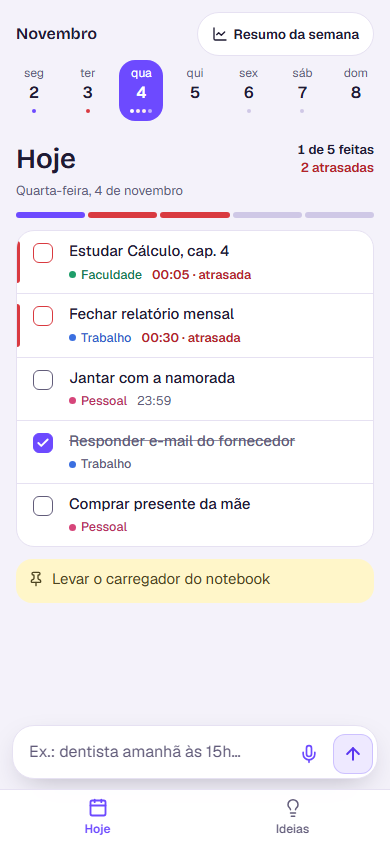
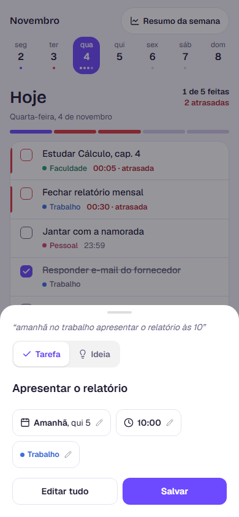
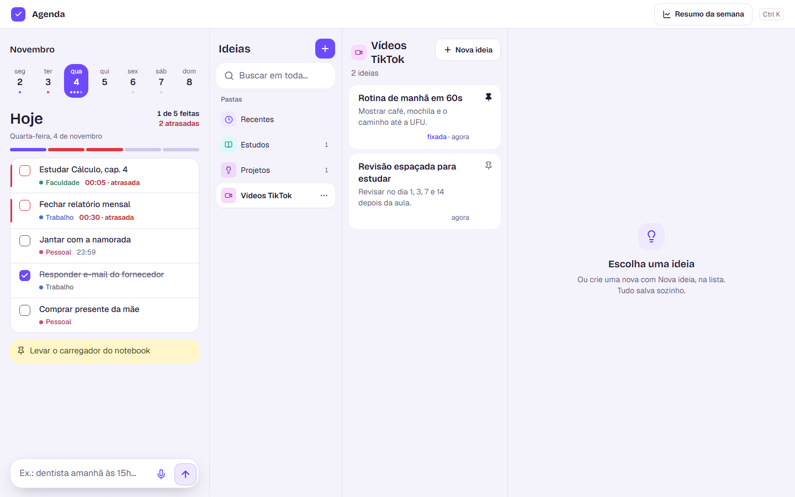

# Agenda

Aplicativo web pessoal para organizar a semana e o dia a dia. Reúne tarefas do dia, captura rápida por texto ou voz interpretada por IA, um resumo semanal de desempenho e um espaço de ideias organizado em pastas. Funciona no celular (instalável como PWA) e no computador, hospedado na Cloudflare com custo zero.

<p align="center">
  
  
  
</p>

<p align="center">
  
</p>

## Funcionalidades

- **Hoje:** tarefas do dia com faixa da semana, placar (feitas, atrasadas, não feitas) e anotação fixada do dia.
- **Captura rápida:** o usuário escreve ou fala uma frase livre (ex.: "estudar cálculo amanhã às 14h"); a IA interpreta título, data, horário e área, e tudo passa por uma tela de confirmação editável antes de salvar.
- **Áreas:** cada tarefa recebe uma etiqueta (Trabalho, Faculdade ou Pessoal) identificada automaticamente.
- **Resumo semanal:** desempenho de segunda a sábado, gráfico dia a dia e lista do que ficou pendente.
- **Ideias:** notas em pastas, com título, texto, link com prévia e opção de fixar ou transformar em tarefa.
- **Acesso protegido:** o app só abre após login.

## Tecnologias

| Camada | Tecnologias |
|---|---|
| Frontend | React 19, TypeScript, Vite, Tailwind CSS, PWA |
| Backend | Cloudflare Workers, Hono, Zod |
| Banco de dados | Cloudflare D1 (SQLite) |
| IA | Workers AI (interpretação de texto e transcrição de áudio com Whisper), com regras de reserva |
| Autenticação | Cloudflare Access (verificação de JWT com `jose`) |
| Testes | Vitest (unidade e Worker) e Playwright (ponta a ponta) |

## Arquitetura

Um único Cloudflare Worker serve a interface (arquivos estáticos gerados pelo Vite) e a API em `/api/*`.

```
src/        → interface React (telas, componentes e hooks)
worker/     → API (rotas de tarefas, ideias, captura e relatório), autenticação e IA
shared/     → regras de negócio compartilhadas (datas, status, relatório)
migrations/ → estrutura do banco D1
tests/      → testes de unidade, do Worker e de navegador
```

Fluxo da captura: texto ou áudio → Worker → Workers AI (transcrição/interpretação) → validação com Zod → tela de confirmação → gravação no D1. Se a IA falhar ou o limite gratuito acabar, um interpretador por regras assume.

## Como executar

Pré-requisitos: Node.js 20+ e uma conta Cloudflare (plano gratuito).

```bash
npm install
npx wrangler d1 migrations apply agenda --local   # cria o banco local
npm run dev                                       # ambiente de desenvolvimento
```

Testes:

```bash
npm test        # unidade + Worker
npm run e2e     # navegador (Playwright)
```

Publicação:

```bash
npm run deploy
```

## Autor

Hugo Vieira — [GitHub](https://github.com/hugo808ts) · [LinkedIn](https://www.linkedin.com/in/hugo-vieira06)
